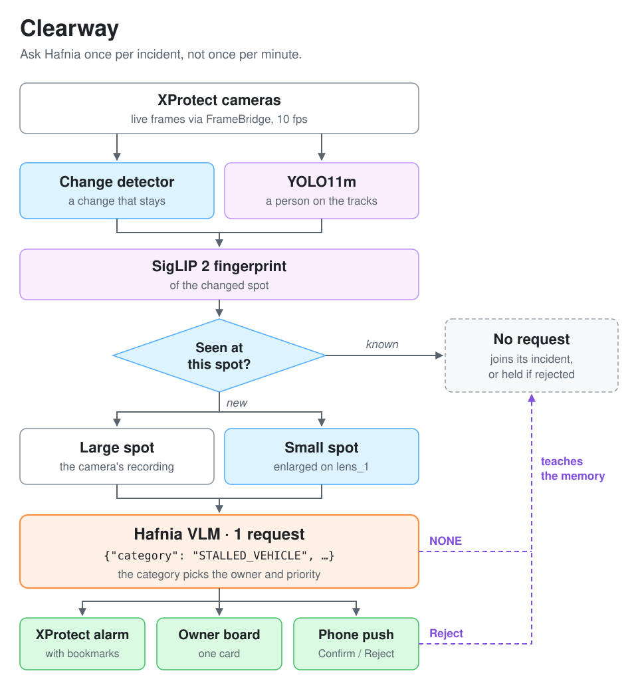

# Clearway

Clearway keeps public ways clear. It watches a city's XProtect cameras for things that block or endanger a way (a
vehicle stalled in a lane, a person on the tracks, an e-scooter dropped across a pavement, a bin tipped over, damage
to transit), asks the Hafnia VLM about each of them once, and turns the answer into one XProtect alarm with
bookmarks, one card on an owner board, and one push to the owner's phone with Confirm / Reject. Everything it does
is measured, and the measurements are in this repository.

Entry for the Hafnia Hackathon 2026 (Milestone XProtect 2026 R1, the Hafnia VLM gateway). Solo entry.

## What it is not

Noticing an obstruction with a VLM is table stakes: Milestone's own plug-in verifies alerts, and any entry can send
the gateway a clip. Clearway's point is the **optimization** around the model:

1. **Every request is earned.** No timer, no motion event. A change detector on the live frames notices what stayed
   changed, a verdict memory skips what Hafnia or the operator already judged, a ledger merges the pieces and
   recurrences of one incident. Eleven cameras for three hours cost 33 requests: one per camera-hour on the
   organizers' looped cameras; a real junction raises about 17 candidates per camera-hour at the same setting
   (`run/holdout-20261029`).
2. **Hafnia is shown the right thing.** A small spot is cropped and enlarged on a lens camera of our own (a 30-pixel
   crash the plain window called NONE twice, the crop named); a large one is asked about on its own recording; the
   lens frames carry a code that proves which seconds the recording holds, after its time base was caught up to 9.5 s
   off and the cause removed.
3. **The answer is checked, not trusted.** Dry runs are judged by a stand-in; live answers are scored against the
   expected category and audited against the frames; the wrong ones are traced to causes and the causes removed.
4. **One card per incident, kept right over time.** One alarm, raised once, reopened on recurrence, closed when the
   spot clears; a detector that does not fade on a lasting change; Confirm / Reject on the board and the phone teach
   the memory.
5. **Measured and reproducible.** Every run folder under `run/` carries its numbers and a README; decisions replay
   offline from the logs; the setup is one script.

## What a judge sees

- **Smart Client:** one alarm per incident on its camera, named with the category, the owner and Hafnia's summary
  (marked AI-generated), with a snapshot and bookmarks on the camera and, for a cropped clip, on `lens_1`; it closes
  by itself when the spot clears and reopens on a recurrence.
- **The owner board** (`http://127.0.0.1:8765/`): a column per owner (Rail control, Traffic operations, Street
  services, Asset owner, Security), a card per incident with the clip Hafnia judged, the snapshot, the summary, the
  time open, the recurrences, the alarm state, and Confirm / Reject; `/summary` is the shift summary (cards, time to
  card, requests per camera-hour, the hotspots on each camera's scene).
- **The phone:** a push per card through ntfy with the snapshot and two buttons; a tap reaches the ledger within
  seconds.

## Numbers

| What | Result | Where |
|---|---|---|
| Three-hour live shift, eleven cameras (M3, 2026-10-26) | 33 requests, 11 cards, 4 of them false; all four traced to the lens's time base, then fixed | `run/clearway-live-20261026T141534Z-m3/README.md` |
| Clean live run under the day's fixes, eleven cameras, 20 min (2026-10-27) | 14 requests, 7 cards, none false, 12 of 14 categories as expected, cards 20-42 s after the change, 331 recurrences carded without a request | `run/clearway-live-20261027T124112Z-clean/README.md` |
| First live test, six cameras | 10 requests, 6 of 6 categories right, one card per incident | `run/clearway-live-20261025T083623Z` |
| Direct asks for large spots | the card 13 s after the change (lens cards 22-47 s), 6 of 6 right | `run/clearway-live-20261027T081803Z-direct/README.md` |
| The lens's time base, read back from its own frames | +0.02 s on a quiet machine, +0.4 to +1.4 s under load; the old stamping ran up to 9.4 s behind under the same load | `run/lens-check-20261027T095146Z-load-wallclock/README.md` |
| The fade: 30-minute replays of two looped cameras | before 16 of 119 loops caught on both, silent after 7 minutes; after 119 of 119, reports steady | `run/change-fade-after3/README.md` |
| Where the CPU goes with eleven cameras | the Recording Server under 2 %; our service 56-62 %, FrameBridge 22-28 % (the MIP library decodes client-side); the detector on every second frame lifted the delivered rate from 4.7 to 7.5 fps per camera; the service below normal priority took XProtect's alarm actions from 19 s to 0.2 s | `run/clearway-dry-20261027T121705Z-width0/README.md`, `-123136Z-detect2`, `-134043Z-priority` |
| Held-out check on three real streets the entry had never seen (CC0 clips, 2026-10-29) | the detector at the real-camera setting: 3 candidates in 11 minutes, about 17 per camera-hour; Hafnia with the service's prompt on 39 hard negatives: 8 right, 31 false cards (20 waiting cars called stalled, 5 invented collisions, 6 obstructions, "a fallen tree trunk" three times). The limit of the entry as it stands, and the next thing to fix | `run/holdout-20261029/README.md` |
| The plain way against Clearway on the same eleven cameras (2026-10-29, 66 requests) | the organizers' example question asked about every camera once a minute: 60 requests per camera-hour, half of each camera's time looked at, the day's 500 gone in 45 minutes; 66 paragraphs to read for six minutes, each incident reported six times, the person on the tracks never (0 of 6), the e-scooter once; nothing invented on the ordinary street scenes, and the smashed window reported every time, which Clearway never asks about because nothing stays changed. Clearway on the same loops: 14 requests for 20 minutes, 7 incidents, none false; 1 request per camera-hour over the three-hour shift | `run/vanilla-20261029T0714Z-compare/README.md` |
| A second question in Hafnia's alert-validation form, the first answer put back to confirm or discard (2026-10-29, 49 requests) | removed 19 of the 31 false cards above (all 5 invented collisions; waiting cars only when the whole junction was in view, 11 of 13, against 8 of 18 crops) and kept 15 of 18 true incidents, but held 2 of the 3 people on the tracks; confidence 0.95 on every answer. Measured, not adopted as a gate; possible as a priority signal | `run/validate-20261029/README.md` |

The analysis behind the day's fixes: `docs/INVESTIGATION-2026-10-27.md`. The product plan, with the schedule and
the risks: `docs/PRODUCT.md`. The pipeline's design and gates: `docs/PLAN-C.md`. Working notes for the repository:
`CLAUDE.md`.

## How it works



The same pipeline as a flowchart, with what the operator's verdicts change: `docs/walkthrough/flow.mermaid`; the
step-by-step walkthrough with a figure and the numbers for each step: `docs/walkthrough/index.html`.

- The **change detector** is Porikli's dual-rate background: a pixel that differs from the slow background but not
  from the fast one has arrived and stopped. People standing in a change hold it back until they leave; whole-frame
  changes (light, fog) are not objects. A change at a danger zone (`config/zones.json`: the track bed) is a person
  trigger.
- The **ledger** decides whether to ask: a new look at a new spot is a question; the same look at the same spot
  joins the open incident; a look Hafnia or the operator rejected is skipped (and asked after all if it stays
  30 s). The answer's category names the owner and the priority.
- The **lens camera** `lens_1` is an RTSP camera of our own (MediaMTX + ffmpeg) that plays each question's crop,
  enlarged, so that Hafnia, which only reads XProtect recordings, sees a small spot large. Every frame carries a
  code; the service reads it back from `lens_1`'s own live frames and asks about the seconds the recording really
  holds.
- The **prompt** is JSON: category (PERSON_ON_TRACKS, COLLISION, STALLED_VEHICLE, OBSTRUCTION, DAMAGE, TAMPERING or
  NONE), a one-sentence summary, the evidence. It is one plain paragraph on purpose: in a comparison on 28 clips
  the service had sent from the eight looped scenes on this machine (the same scenes the prompt had been written
  against, so a comparison between prompts, not a held-out accuracy), the paragraph kept every answer while a
  sectioned layout, added context and rules, a confidence field, Hafnia's trained validation format and two system
  prompts each lost 4 to 10 of the 28 (`run/prompt-20261028T1605Z`). On three real streets it had never seen (CC0
  clips of junctions in Mumbai and Düsseldorf), the same prompt turned ordinary stopped traffic into incidents: 31
  of 39 hard negatives became false cards, most of them cars waiting at a light called stalled
  (`run/holdout-20261029`). That is the known limit of the entry as it stands: the fix lies upstream of the model
  (how long a vehicle must stay before a question, the operator's rejections teaching the memory) and is not
  built. A floor in square metres, from a scale per camera and row fitted on the people and cars in view, was
  measured and does not help: the true incidents and the false cards overlap in size, so a floor that removes the
  junction's waiting cars removes the school gate and the graffiti first, and a floor set low enough for the far
  rows multiplies the candidates eight times with the false cards unchanged (`run/calib-20261029`). A second
  question in Hafnia's own alert-validation form, the first answer put back to the model to
  confirm or discard, was measured and not adopted as a gate: it removed 19 of those 31 false cards (every
  invented collision among them) but also held 3 of 18 true incidents, two of them a person on the tracks
  (`run/validate-20261029`). Nothing in XProtect is wired to Hafnia on its own: no motion event or gateway rule
  ever sends a clip.

## Run it

On a hackathon machine (XProtect 2026 R1 and the Hafnia gateway installed, the organizers' cameras present), from a
fresh clone, in an elevated PowerShell:

```powershell
powershell -NoProfile -ExecutionPolicy Bypass -File setup.ps1          # everything; asks for the gateway password once
```

`setup.ps1` is idempotent and explains itself at the top: Python 3.12, the virtual environment, ffmpeg, the .NET 8
SDK and FrameBridge, MilestonePSTools, the lens camera, the model weights, the gateway password (a user-scope
environment variable, never a file), optionally the phone (`-Ntfy`), the board, and a check that costs no request.

Then, in a PowerShell that has the user-scope variables (a new one, or load them as in `CLAUDE.md`, "Commands"):

```powershell
# A dry run on the six incident cameras: no request, a stand-in answers; alarms named "[dry run]"
.venv\Scripts\python.exe scripts\run_clearway.py --minutes 5 --alarms --close-alarms-at-end

# Live: at most 12 requests, alarms, phone pushes; the planned count is printed before anything starts
.venv\Scripts\python.exe scripts\run_clearway.py --minutes 10 --answers hafnia --max-requests 12 --alarms --notify

# All eleven organizer cameras (the five street clips at the real-camera setting)
.venv\Scripts\python.exe scripts\run_clearway.py --cameras vehicle_breakdown_traffic_queue bin_pushed_over_onto_sidewalk escooter_left_across_sidewalk school_gate_break_in_night person_on_railway_tracks graffiti_on_standing_train busy_street highway_traffic_overcast_weather city_street_7_condensation_inside_housing vandalism traffic_flows_in_the_open_lanes --real busy_street highway_traffic_overcast_weather city_street_7_condensation_inside_housing vandalism traffic_flows_in_the_open_lanes --minutes 30 --answers hafnia --max-requests 40 --alarms --notify

# The board, as its own window beside Smart Client (it follows the newest run)
powershell -NoProfile -ExecutionPolicy Bypass -File scripts\open_board.ps1

# Per camera: questions, cards, time to card, the lens's offsets, Hafnia against the stand-in
.venv\Scripts\python.exe scripts\report_clearway.py run\clearway-live-<UTC> --xprotect
```

Each run writes `run/clearway-<dry|live>-<UTC>/` with `service.jsonl` (everything that happened), `ledger.jsonl`
(replayable), `incidents.json`, `shift.json`, and the board's snapshots and clips. The daily allowance is 500
requests; the run script refuses to plan past `--stop-at` (450 by default).

## Reproduce the measurements (no requests)

```powershell
.venv\Scripts\python.exe scripts\eval_change.py --loops 120 --only bin_pushed_over_onto_sidewalk escooter_left_across_sidewalk   # the fade: 30 min of loops
.venv\Scripts\python.exe scripts\eval_change.py --loops 120 --only bin_pushed_over_onto_sidewalk --no-freeze              # ... the detector before the fix
.venv\Scripts\python.exe scripts\eval_ledger.py                                 # the ledger's decisions replayed offline
.venv\Scripts\python.exe scripts\check_lens.py --minutes 3 --clips 4 --export   # the lens's time base, the recording read back
```

Run one of these at a time: the machine has 15.7 GB with XProtect resident, and each loads a model.

### The held-out check on real streets (40 requests)

The three street clips are public (CC0); `scripts/fetch_footage.py` fetches them from Wikimedia Commons and checks
their SHA-256 (about 500 MB). Then the detector offline, the clips on the lens camera, one request per clip, the
score. Details and what to expect: `run/holdout-20261029/README.md`, "Reproduce it on another machine".

```powershell
py scripts\fetch_footage.py
.venv\Scripts\python.exe scripts\holdout.py detect --out run\holdout-<date>      # no request
Copy-Item run\holdout-20261029\labels.json run\holdout-<date>\
.venv\Scripts\python.exe scripts\holdout.py play run\holdout-<date>              # on the lens camera
.venv\Scripts\python.exe scripts\holdout.py ask run\holdout-<date>               # 40 requests; --dry-run prints the plan
.venv\Scripts\python.exe scripts\holdout.py score run\holdout-<date>
```

## Repository

`clearway/` the service, ledger, prompt, alarms, board, notifier, shift summary; `tier0/` the change detector, the
SigLIP verdict memory, the danger zones; `lens/` the lens camera (publisher, frame code, clock, client);
`bridge/FrameBridge/` the C# live-frame bridge; `hafnia/` the gateway and XProtect REST clients; `incident/` the
bridge reader and the earlier plan A pipeline; `scripts/` the run, setup, evaluation and report scripts; `config/`
owners and zones; `docs/` plans and the investigation; `run/` every measured run with its README (the raw logs
each run wrote stay local; the README keeps the numbers). The full table with one line per file is in `CLAUDE.md`,
"Repository layout".

## Licences and footage

Our code is the entry's. Components: Ultralytics YOLO11 (AGPL-3.0), SigLIP 2 (Apache-2.0, google/siglip2-base-patch16-224),
Real-ESRGAN weights (BSD-3-Clause; optional, not in the default lens), spandrel (MIT), MediaMTX (MIT), ffmpeg
(gyan.dev build, GPL), MilestonePSTools and the MIP SDK (Milestone's terms), psutil (BSD). The organizer cameras'
clips belong to the organizers and stay on the machine. The three street clips of the held-out check are CC0 on
Wikimedia Commons ("Street in Mumbai (video) 02" and "03" by Nicolas Vigier, 2016; "Straßenverkehr in Düsseldorf"
by Slick, 2014); `scripts/fetch_footage.py` fetches them with their checksums, and they are git-ignored for size.
The AI City Challenge clip used for `test_11` may not be redistributed and is not in the repository; other candidate
footage and its licences are listed in `docs/PLAN-near-miss.md`. Frames and clips under `run/` are git-ignored for
the same reason.

## Status (2026-11-01)

Built and measured: the pipeline, alarms and bookmarks, the board, person triggers, the shift summary, hotspots,
phone pushes, direct asks, the lens self-check, the fade fix, the held-out check on real streets, the comparison
with asking on a timer. Measured and left out of the product: super-resolution and BEFORE/AFTER stills for the
lens, a confirming second question, a size floor in square metres; their code stays in the repository for the
measurements (`lens/enhance.py`, `scripts/second_question.py`, `scripts/scale_fit.py`), and the service never
loads it. Not built: a Smart Map layer and the gate's dwell trigger; the application layer beyond the board and the
phone is a TODO (`docs/PRODUCT.md`, F13). The demo video (under 3 minutes) and the submission are due by 2 November
2026, 12:00 CET.
