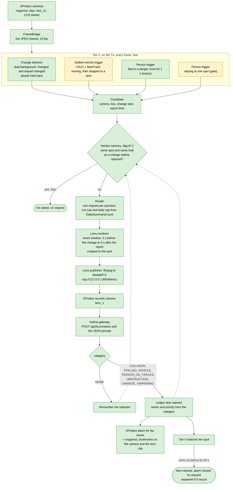

# Plan C: right-of-way incidents (decided 2026-10-22, updated 2026-10-24)

Status: **technical plan.** The product built on it, with the current scope and schedule, is in `docs/PRODUCT.md`
(2026-10-24); where they differ, `docs/PRODUCT.md` wins. Supersedes `docs/PLAN.md` (verified accident alarms) and `docs/PLAN-near-miss.md` (near-miss
observatory); both stay as reference, and their parts are reused below. Submission about 2026-10-30. Judging weighs
creativity and validity most; reproducibility counts.

**In one paragraph.** City and transit operators need to know when something blocks or endangers a public way: a
vehicle broken down in a lane, an e-scooter or a bin lying across a pavement, a person on the tracks, damage to a train.
Tier 0 watches every camera for free and notices that *something changed and stayed changed*, without knowing what it
is (no per-scenario rules, no object classes). A verdict memory (SigLIP 2) skips changes that look like ones Hafnia
already rejected at the same spot. The lens shows Hafnia the rest the way a VLM can read it: a window around the
moment the change happened and its outcome, cropped to the spot. Hafnia names what changed in a structured answer;
the category decides whose job it is. Each confirmed change becomes an item in a ledger and an XProtect alarm for the
owner; tier 0 closes the item, without another request, when the spot looks as it did before.

## Why this direction (evidence, 2026-10-19 to 10-22)

- **The organizers' six new cameras** (2026-10-21; synthetic, 15–17 s loops, on every machine) are incidents in public
  ways: a breakdown with a queue, a bin tipped over and an e-scooter left across a pavement, a person on railway tracks,
  graffiti on a train, a school-gate break-in. They were added because participants asked for them, so many entries
  will demo "detect this scenario" on the same clips. Named-scenario detection on these loops will be crowded.
- **Hafnia can read these scenes** (`run/probe-20261022T054342Z`, 18 requests): one-word class 7 of 9 right,
  descriptions 51 of 64 claims right. **Its errors are structural** (`audit.md`): stories told in the order of a loop
  cut (time reversed: the e-scooter "mounted and ridden away"), traffic and weather priors ("wet pavement" on dry
  ground, vehicles in a pedestrian crowd), an invented outcome ("successfully cut the lock"). Most come from a window
  that is not centred on the event; that is what the lens fixes.
- **The lens works** (`run/lens-test_11-20261021T144445Z`): on a distant crash the plain window got NONE twice; the
  same window cropped and enlarged got ACCIDENT twice.
- **Measured since (2026-10-23):** the structured JSON prompt with category definitions named every incident right in
  every view (30 of 30, `run/pilot-20261023T162040Z`); event windows avoid the loop-cut reversals that full-loop windows
  still make; super-resolution and BEFORE/AFTER stills brought no gain (`run/lens-test_11-20261023T165151Z`); a crash
  was called "stalled" because the category list had no crash category.
- **Real footage keeps us honest:** on real crime CCTV Hafnia scored 0 of 8 (`run/bench-20261018`); synthetic clips are
  easier. We report on both, and stay in the road-and-public-space domain where Hafnia is competent; security
  (break-in) is a footnote, not the product.
- **Prior and competing entries** are application work (`docs/PLAN-near-miss.md`, "What earlier and current entries
  did"); the 2026 "Scene Contracts" entry uses fixed per-camera templates (property damage, roadway visibility). Ours
  needs no per-camera rules and measures what it claims.

## Who it is for

| What changed | Where | Owner | Alarm priority |
|---|---|---|---|
| Person on the tracks | rail track, platform edge | rail control (stop trains) | High, urgent |
| Vehicle crash (a collision, a vehicle spinning into a barrier) | road lane | traffic operations, emergency services | High, urgent |
| Vehicle stopped in a traffic lane (breakdown, crash aftermath) | road lane | traffic operations, towing | High |
| Object lying across a pavement or path (e-scooter, bin, debris) | pavement, cycle path | micromobility operator, sanitation, street maintenance; an accessibility hazard for wheelchair users and blind people | Medium |
| Damage to transit or street assets (graffiti, broken window) | train, building, street furniture | asset owner | Low |
| Lock or gate tampered with | gate | security (footnote: outside Hafnia's strength) | Low |

## Pipeline

Green: built and measured (live since 2026-10-25: `clearway/service.py`, `run/clearway-live-20261025T083623Z`).
XProtect alarms and bookmarks since 2026-10-25 too (`clearway/alarms.py`, F3, `run/clearway-dry-20261025T090255Z`).
The danger-zone trigger too (`tier0/zones.py`, F5). Yellow: to build (the stalled-vehicle rules exist from plan A and
need plan C's keys; the gate's staying-at-a-spot trigger, F11). Tested and **not** in the
default lens: super-resolution (`lens/enhance.py`) and BEFORE/AFTER stills (`lens.client.before_after`), both kept as
options.

## Components

| # | Component | Status (2026-10-25) | What |
|---|---|---|---|
| 1 | Change detector (`tier0/change.py`) | **built, G1** | Dual-rate background (Porikli et al., 2008) with a median warm-up; per-pixel static time that pauses while something moves across a spot; people held back; whole-view changes ignored; each change closed when its spot matches its BEFORE snapshot. Two settings: `ChangeParams.loops()` (synthetic clips) and `.real()` (640 px, 0.15%, 15 s). |
| 2 | Verdict memory (`tier0/memory.py`) | **built, offline** | SigLIP 2 (`google/siglip2-base-patch16-224`, Apache-2.0) embeddings of each changed spot, kept with Hafnia's verdict; a change at a rejected spot that looks like the rejection is not sent. 45% fewer requests, no incident skipped, against a stand-in for Hafnia (`run/memory-compare`). |
| 3 | Stalled-vehicle trigger | to build | A vehicle track that was moving and has stood still for ≥ N s in a lane (`tier0/rules.py`, `sharp_decel`). Covers the breakdown and crash aftermaths. |
| 4 | Person triggers | danger zone **built, live** (F5); staying at a spot to build (F11) | `tier0/zones.py`: a person's feet (bottom centre of YOLO's box, 5 fps) inside a danger-zone polygon for ≥ 1 s is reported like a change; closed after 2 s empty. One polygon per camera in `config/zones.json` (the only per-camera setting); the tracks' polygon is everything beyond the near platform's yellow tactile strip, its edge fitted by colour. Live: the person on the track reported in every loop, PERSON_ON_TRACKS from Hafnia. To build: a person staying at one spot for ≥ N s (gate). |
| 5 | Router | **built, live** | In the service (`clearway/service.py`, `HafniaAnswers`): one request per ledger question, a run cap, none once today's `DailySummaryCount` reaches a limit. Not built: urgent first. The single lens camera is the bottleneck (first cards 36–85 s after the change when six incidents start within a minute). |
| 6 | Lens | **built, M1** | `lens/` (publisher, client, `lens_1`): event window from 2 s before the change started to 3 s after it was reported, cropped to the spot. Options measured and left out of the default: Real-ESRGAN super-resolution (`lens/enhance.py`), BEFORE/AFTER stills (`before_after()`). |
| 7 | Prompt and parser | **built, M1, G3** | `clearway/prompt.py` `PROMPT`: JSON with `category` (`PERSON_ON_TRACKS`, `COLLISION`, `STALLED_VEHICLE`, `OBSTRUCTION`, `DAMAGE`, `TAMPERING`, `NONE`, each defined), `object`, `where`, `still_present`, `summary`; parsed in code with a keyword fallback. Use the category and `still_present`; treat `object` details (tool types) as unreliable. Live: 10 of 10 valid JSON, 6 of 6 incidents right. |
| 8 | Ledger and XProtect | **built, live** (F1, F2, F3) | `clearway/ledger.py`: one record per incident (pieces, recurrences, provisional skips, merges, clearing, failed questions), event log replayable. `clearway/alarms.py`: one XProtect alarm per incident on its camera, priority by category, owner in the name, Hafnia's summary, a snapshot, bookmarks on the camera and on the lens clip; closed once the incident has stayed cleared for 60 s, reopened when it recurs. Operators' verdicts (F7) go into the same memory: a rejected card's looks are skipped at its spot, a confirmed card's alarm goes to In progress. |
| 9 | Ledger page | **built** (F4) | `clearway/board.py`: the owner board, a web page on 127.0.0.1:8765 following a run folder (the ledger's log applied incrementally): cards by owner with the lens clip (MP4 made from the spool), the camera's view with the spot boxed, summary, time open, recurrences, alarm state, Confirm / Reject buttons (F7); questions being checked; requests used. Its own window beside Smart Client (`scripts/open_board.ps1`): Smart Client's HTML page item falls back to Internet Explorer on this machine. |
| 10 | Setup | partly | `scripts/setup_lens.ps1` exists; `setup.ps1` for a fresh machine; CC0 footage fetched by script from Wikimedia Commons. |

## Cameras and footage

All on every machine unless noted, so judges can reproduce the main results without our data.

| Camera | Role |
|---|---|
| `vehicle_breakdown_traffic_queue` | Stalled vehicle in a lane (High) |
| `bin_pushed_over_onto_sidewalk`, `escooter_left_across_sidewalk` | Obstruction on a pavement (Medium); the same street and bin: one view, two incidents |
| `person_on_railway_tracks` | Person in a danger zone (urgent) |
| `graffiti_on_standing_train`, `vandalism` | Damage (Low) |
| `school_gate_break_in_night` | Tampering (footnote) |
| `traffic_flows_in_the_open_lanes` | Roadworks present all the time: must *not* open an item (nothing changes) |
| `busy_street`, `highway_traffic_overcast_weather`, `city_street_7_condensation_inside_housing` | Negatives: crowds, fog, a camera fogging up (the detector must not call a whole-frame change an incident) |
| `test_11` (ours, AI City video 91; internal only, licence not cleared) | Real crash aftermath: an SUV stopped against the median wall |
| Mumbai 02 and 03, Düsseldorf (ours, Wikimedia Commons, CC0; to inject) | Real busy streets: false items per hour |

Loops: an incident's lasting state ends when its clip restarts (after about 3–8 s). The detector treats the restart
as a scene reset; each loop is one more trial of the same incident, and the ledger counts it once per loop.

## Measurements (validity)

- **M1 Lens.** On the six new cameras: full-loop window vs event window vs crop vs crop with super-resolution vs
  BEFORE/AFTER, plus test_11's small crash. **Done 2026-10-23** (39 requests): categories at the ceiling (30/30);
  summaries favour event windows; super-resolution and BEFORE/AFTER no gain. Asking again about the same span returns
  the same answer, so repeats need different events or windows, not re-asks.
- **M2 Detector, offline.** Every camera's clip (and the CC0 clips): incidents caught per loop, time from the change to
  the candidate, false candidates per hour on the negatives. No requests.
- **M3 End to end, live.** All incident cameras for an hour or more: items opened and closed per loop, precision and
  recall, time from change to alarm, time to close, requests per hour and cameras one 500-a-day allowance covers.
- **M4 Real footage.** `test_11` and the earlier real accident cameras (aftermaths), the CC0 streets: does the same
  pipeline hold outside synthetic loops? False items per hour, misses, audited answers.

## Gates

| Gate | Test | Requests | Pass | If it fails |
|---|---|---|---|---|
| G1 Detector | M2 on all clips | 0 | the incident caught on ≥ 5 of 6 incident cameras in every loop; nothing on `traffic_flows`, `highway`, `busy_street` | **Passed for the object incidents 2026-10-23** (`run/change-G1-loops`): breakdown, bin, e-scooter, graffiti in every loop; the two person incidents (tracks, gate) need person triggers (the gate's apparent catches were lit pavement and shadow beside the person); nothing on roadworks or highway; `busy_street` 10 false reports in 93 s at the loops setting, 0 at the real-camera setting. The verdict memory then cuts requests by 45% with no incident skipped (`run/memory-compare`) |
| G2 Lens | M1 pilot (1 repeat first, about 24 requests) | 24 | centred or before/after beats the full-loop baseline on category accuracy | **Not decidable 2026-10-23** (`run/pilot-20261023T162040Z`, 30 answers): with the JSON prompt every category was right in every view (30/30). Summaries: the full loop again reverses the gate across the loop cut; BEFORE/AFTER one regression. On test_11's small crash (`run/lens-test_11-20261023T165151Z`, 9 requests) super-resolution gave the bicubic answer word for word, and the crash was called STALLED_VEHICLE for lack of a crash category. **Decided:** event window + crop + JSON prompt; add COLLISION |
| G3 Crash category | test_11's crash, full frame / crop / crop with SR, with COLLISION in the prompt | 3 | the crash is named (COLLISION, or the summary mentions the impact) | **Passed on the crop 2026-10-24** (`run/lens-test_11-20261024T110155Z`): crop and crop+SR COLLISION ("loses control … veers sharply"), full frame STALLED_VEHICLE; an invented second vehicle in the summary. Regression check (`run/pilot-20261024T111134Z`, 6 requests): the six synthetic incidents keep their categories (6/6), none becomes COLLISION |

## Schedule (revised 2026-10-24; superseded from Oct 24 by `docs/PRODUCT.md`)

The allowance resets at 00:00 UTC (the machine's clock); stay under `--stop-at` each day.

| Day | Date | Work | Requests |
|---|---|---|---|
| 1 | Oct 22 | **Done:** this plan; the six new cameras probed and audited. | 18 |
| 2 | Oct 23 | **Done:** change detector and G1; verdict memory; super-resolution; BEFORE/AFTER renderer; lens pilot (G2); small-object test. | 39 |
| 3 | Oct 24 | COLLISION retest (G3). Person triggers, stalled-vehicle trigger. Live pipeline: FrameBridge → triggers → memory → router → lens → Hafnia → ledger, alarm, bookmark; auto-close. | 30 |
| 4 | Oct 25 | M3 live runs on all cameras; fixes. Machine restart (organizers; participant). | 150 |
| 5 | Oct 26 | M4: inject the CC0 clips (Recording Server restart: ask first); real-footage runs. | 100 |
| 6 | Oct 27 | Ledger page; alarm definitions and priorities in XProtect. | 20 |
| 7 | Oct 28 | Final measurements, report with charts and audits. | 150 |
| 8 | Oct 29 | `setup.ps1`, README, demo video. | 30 |
| 9 | Oct 30 | Spare; submission. | |

## Risks

| Risk | Fallback |
|---|---|
| The before/after layout confuses Hafnia (unusual for a model trained on CCTV clips) | Measured: no gain, one regression (a lying scooter read as "parked"); not in the default |
| The category list steers the answer (a crash called "stalled" when no crash category exists) | Add COLLISION; test each new category on a clip that should fall into it |
| Hafnia's cloud refuses a specific clip ("HTTP 403 Forbidden" on upload, twice for the same span) | Shift the window by 1 s and ask again (the failure is free; it worked in the pilot) |
| The change detector fires on light changes, shadows, parked cars | Persistence and size thresholds, whole-frame changes ignored, YOLO tracks to explain moving things; Hafnia's NONE closes the rest (that is its job) |
| States last only 3–8 s in the loops | Short persistence threshold for the demo; state it plainly; real footage (M4) shows longer states |
| Synthetic clips flatter the results | Report synthetic and real separately; audit claims, not only labels |
| Hafnia misses tampering (as with real crime) | Footnote it; the product is right-of-way, not security |
| The lens stream drops | Keep the publisher running; plain centred windows still work |

## What carries over

From plan A: FrameBridge, tier 0 tracking and rules, the router, the gateway and XProtect clients (alarms, bookmarks),
the measured findings in `CLAUDE.md` (event-centred windows, latency, describe vs classify). From the lens work:
`lens/`, `lens_1`, the setup and start scripts. From plan B: the footage survey and the CC0 clips. Dropped: near-miss
counting and its statistics (no near misses in the shared footage, too little real footage, 8 days left).

## Sources

- Organizer note and kit (2026-10-21): `C:\HackathonKit\xprotect-hackathon\SKILL.md`, "Your cameras"
- Probe and audit: `run/probe-20261022T054342Z/README.md`, `audit.md`
- Lens tests: `run/lens-test_11-20261021T144445Z/README.md`, `run/lens-test_11-20261023T165151Z/README.md`
- Change detector (G1): `run/change-G1-loops/README.md`; verdict memory: `run/memory-compare/README.md`
- Lens pilot (M1, G2): `run/pilot-20261023T162040Z/README.md`
- Dual-foreground abandoned-object detection: F. Porikli, Y. Ivanov, T. Haga, "Robust abandoned object detection using
  dual foregrounds", EURASIP Journal on Advances in Signal Processing, 2008
- Hafnia's trained formats and earlier research: `docs/PLAN-near-miss.md`, "Why consider a change"
