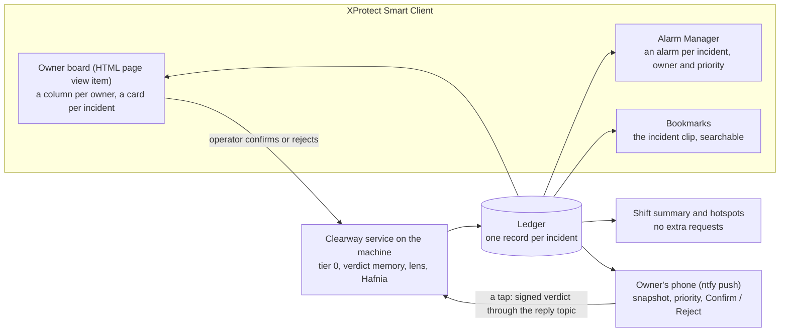

# Product plan: Clearway (working name), 2026-10-24

Status: **current.** This turns plan C (`docs/PLAN-C.md`, the pipeline and its measurements) into something an operator
uses. Plan C stays the technical reference; where the two disagree on scope or schedule, this document wins.
**Submission portal: 26 October to 1 November 2026, 12:00 CET** (the Hafnia community's hackathon page, read
2026-10-27); finalists announced 3-6 November, finals 10-11 November at the Developer Summit in Copenhagen. Required:
a working solution (PoC or MVP), a solution description, a demonstration video (3-5 min recommended), the source code
(open source not required); optional: a live demo link and documentation. Criteria: real-world value, innovation, use
of Hafnia VLM and XProtect (higher scores for feeding results back into XProtect as events, alerts or actions),
technical execution, functionality, demo and user experience. Plan: submit on Oct 30, a day's buffer. A "clearway" is
a road where stopping is not allowed: the product keeps public ways clear.

**Progress (2026-10-27):** F1-F9 and F12 are built (F6 is the prompt's COLLISION category; F12 gained phone pushes
with Confirm / Reject on 2026-10-27); F10 and F11 are not started; F13 (application layer) is a TODO for later. M3, the three-hour live shift on all eleven cameras, ran on 2026-10-26
(`run/clearway-live-20261026T141534Z-m3`): 11 cards, 4 false, all from the start-up minutes; 32 requests. It found
three problems to fix before the demo (Risks): answers that may describe another camera's clip, looped incidents
fading from the detector after about 10 minutes, and XProtect taking 35-62 s per alarm action with eleven cameras.
All three were dealt with on 2026-10-27 (Risks): the lens recording checked against the clips sent and the time base
measured, fixed and read back from the frames themselves; the fade found in code and fixed, verified offline; the
slowness traced to our own CPU use, not XProtect's, and halved. The README and `setup.ps1` are written. The clean
live run under the new defaults (`run/clearway-live-20261027T124112Z-clean`, 20 minutes on eleven cameras, 14
requests): 7 cards, none false, 12 of 14 categories as expected, cards 20-42 s after the change, 331 recurrences
carded without a request. The alarm actions' latency is fixed (the service below normal priority: 0.2 s per raise)
and the prompt's definitions now say what each category is not (the graffiti filed OBSTRUCTION became DAMAGE on
re-asking, nothing else changed). Next: F10, M4, the report and the video (Schedule).

## The operator's question

> **What is blocking a public way right now, whose job is it, and how long has it been there?**

Clearway answers it on one board, inside XProtect Smart Client. Each card is one incident: what it is, the short clip
that shows it, whose job it is, how long it has been open. Cards close themselves when the way is clear again. At the
end of a shift the board summarises what happened and where it keeps happening.

The pipeline we built (change detection, verdict memory, lens, Hafnia) is the reason to trust the board, not the
product itself. The pitch leads with the board and uses the measurements as evidence.

## Why this framing (evidence, 2026-10-24)

- **Every 2025 finalist built something a person uses** (a map, a triage view, a recap, a workflow builder); none
  improved the model (`docs/PLAN-near-miss.md`, "What earlier and current entries did"). The winner wanted something
  "relevant and useful in real life"; the judges (Milestone and NVIDIA) said he "really nailed it". The 2025 results
  name no criteria.
- **The organizers' own idea list** (`hackathon_qna.png`) names "Smart dashboards: turn video understanding into
  safety, traffic and incident dashboards for operators" and "Video summaries: shift summaries, explanations of unusual
  activity and structured data from hours of footage". The board and the shift summary are both on it.
- **Our gap:** plan C stops at "an alarm fires in XProtect". The ledger and the page that would show it to a person were
  still "to build" and scheduled last.
- **Our strength stays:** no 2025 entry measured or improved what the VLM sees. Here that work becomes product
  properties a judge can check: few false cards, the right clip on each card, no request wasted on repeats.

Source of the framing: an external review of the plan (2026-10-24), checked against the 2025 press material, the
organizers' list and Milestone's documentation.

## What sells it against the field (2026-10-27)

Two of this year's entries are public on GitHub (looked up 2026-10-27): RoadWatch (road obstructions with Hafnia and
XProtect, by a 2025 finalist) and Scene Contracts (a camera's "operational responsibility" as a fixed-template
contract). Both ask Hafnia when an operator clicks or on a bounded timer, judge one recorded interval per request,
hand the result to XProtect as an analytics event, and claim no accuracy. Noticing an obstruction with a VLM is
table stakes: Milestone's own plug-in verifies alerts, and any entry can send the gateway a clip. The category list
gets one line in the README and the video. What is sold is the **optimization**: a pipeline that decides when to ask
and what to show, measures each answer, and removes the causes of the wrong ones. Five claims, each with its number:

1. **Every request is earned.** No timer and no motion event: a change detector on 10 fps live frames notices what
   stayed changed, a verdict memory skips what Hafnia or the operator already judged, the ledger merges pieces and
   recurrences into one incident. M3: eleven cameras for three hours cost 33 requests, one per camera-hour; a day of
   eleven cameras at that rate is about 260 requests, inside the allowance with room for second looks.
2. **Hafnia is shown the right thing.** A small spot is cropped and enlarged on the lens camera (test_11's distant
   crash: the plain window got NONE twice, the crop named the crash); a large one is asked about on its own recording
   (13 s to a card); the lens frames carry a code that proves which seconds the recording holds, after the lens's
   time base was caught 0.3-9.5 s off and the cause (frames stamped by count) removed.
3. **The answer is checked, not trusted.** Dry runs are judged by a stand-in; live answers are scored against the
   expected category and audited against the frames; M3's four false cards were traced to the time base, not shrugged
   off as model error.
4. **One card per incident, kept right over time.** One alarm, raised once, reopened on recurrence, closed when the
   spot clears; the fade that silenced the detector after half an hour was found in code and its fix is in the replay
   (`docs/INVESTIGATION-2026-10-27.md` 4.3); Confirm / Reject on the board and the phone teach the memory.
5. **Measured and reproducible.** Every run folder carries its numbers and a README; decisions replay offline from
   the logs (`scripts/eval_ledger.py`, `scripts/eval_change.py`); the setup is scripted for a fresh machine.

The README, the demo video and the finals presentation lead with these; the obstruction categories follow.

## Who uses it

| Person | Where | What they need |
|---|---|---|
| Control-room operator (city or transit) | the board in Smart Client | what is open now, in which column, how long; confirm or reject a card |
| An owner team: rail control, traffic operations, sanitation, the e-scooter operator | their column; their XProtect alarm; a push on their phone | only their incidents, with the clip that shows them; confirm or reject from the phone |
| Planner (street or station) | the shift summary and hotspots | where incidents keep happening, how fast they are cleared |

## What a person sees

**A card** (one per incident):
- category and owner, as a coloured column (rail control, traffic operations, sanitation and street maintenance, the
  e-scooter operator, asset owner);
- the lens clip, playing in the card: the cropped, event-centred clip that Hafnia judged is also the best evidence for
  a person, so it does double duty;
- Hafnia's one-sentence summary, marked as AI-generated;
- time since the change began, and its state: open, cleared (closed by itself), confirmed or rejected by the operator;
- recurrences: "same spot, 3rd time today".

**The shift summary** (built from the ledger, no requests), in the shape of Hafnia's trained MonitoringSummary:
incidents by category and owner; median minutes from change to alarm and from alarm to clear; open longest; recurring
spots with a thumbnail.

**Hotspots:** per camera, where incidents keep coming back (from the ledger's boxes and the verdict memory's
embeddings), drawn over the camera image: "e-scooters left here 6 times this shift".

## Features and priorities

| # | Feature | Priority | Builds on | New work |
|---|---|---|---|---|
| F1 | Ledger (**built 2026-10-24**, `clearway/ledger.py`; offline replay `run/ledger-F1`: one card per incident, 9 requests for six incident cameras over 5 min instead of 190, no incident change lost with a stand-in for Hafnia) | P0 | `tier0/change.py` change ids and auto-close | One record per incident: camera, box, times (change, report, answer, alarm, clear), category, owner, Hafnia's answer, clip path, alarm id, bookmark, state, recurrence count, operator verdict. States: candidate → asked → open → cleared / confirmed / rejected. A change at the spot and with the look of an open or recently confirmed incident is a **recurrence**: no request, counter + 1. Without this, a looped incident costs a request every 15 s. |
| F2 | Live pipeline (**built 2026-10-25**, `clearway/service.py`, `scripts/run_clearway.py`; first live test `run/clearway-live-20261025T083623Z`: six incident cameras, 10 requests, one card per incident, 6 of 6 categories right, recurrences carded in 1.4–2.5 s, first cards 36–85 s after the change because the one lens camera plays the questions' clips in turn) | P0 | `incident/` (plan A), FrameBridge, `lens/`, `scripts/lens_pilot.py` prompt | FrameBridge → change detector → verdict memory → router (daily cap) → the crop: a spot the lens would magnify less than 2.5x is asked about on its own camera's recording (**direct asks, 2026-10-27**, `run/clearway-live-20261027T081803Z-direct`: the two direct cards 13.3-13.4 s after the change, the lens's 21.8-47.2 s, 6 of 6 categories right), a smaller one on the lens, its span read back from `lens_1`'s own frames (**lens self-check, 2026-10-27**: a frame code in every lens frame, the publisher stamping with the wall clock; under the eleven-camera load the recording sat +0.4 to +1.4 s from the publisher's clock instead of -4 to -8 s, `run/lens-check-20261027T095146Z-load-wallclock`) → Hafnia (JSON prompt with COLLISION) → ledger. |
| F3 | XProtect alarms and bookmarks (**built 2026-10-25**, `clearway/alarms.py`; dry runs `run/clearway-dry-20261025T090255Z`: one alarm per incident on its camera with the right priority, a snapshot and bookmarks on the camera and `lens_1`; closed once the incident has stayed cleared for 60 s, reopened when it recurs; 0 errors) | P0 | `hafnia/xprotect_rest.py` (trigger, update, close, bookmark) | One alarm per incident, priority and owner from the category, the clip span bookmarked; the alarm closed when the incident clears. |
| F4 | Owner board (**built 2026-10-25**, `clearway/board.py`, `clearway/board.html`, `scripts/start_board.ps1`, `scripts/open_board.ps1`: a column per owner, a card per incident with the clip Hafnia judged playing, the camera's view with the spot boxed, Hafnia's summary, time open, recurrences, alarm state; the changes being checked above. **Not inside Smart Client** on this machine: its HTML page item falls back to Internet Explorer, see Risks; the board is its own window beside it) | P0 | `scripts/viz_pipeline.py` page code | A page served by the Clearway service on the machine (standard-library HTTP server, polling the ledger), cards with the clip (MP4 made from the lens spool), shown in Smart Client as an HTML page view item. |
| F5 | Person on the tracks (**built 2026-10-25**, `tier0/zones.py`, `config/zones.json`; live `run/clearway-live-20261025T092317Z-tracks`: every loop's person on the track reported, 12 occurrences in 3 min on one card, Hafnia PERSON_ON_TRACKS 2 of 2, a High alarm for rail control with Hafnia's summary) | P0 | YOLO person boxes | A danger-zone polygon for the tracks camera (the only per-camera setting): feet inside for ≥ 1 s. Without it the rail-control column is empty. |
| F6 | COLLISION category | P0 | prompt | Gate G3 of plan C: **passed on the crop 2026-10-24** (`run/lens-test_11-20261024T110155Z`; the full frame still says STALLED_VEHICLE). Regression check passed (`run/pilot-20261024T111134Z`): the six synthetic incidents keep their categories, none becomes COLLISION; two summaries had wrong details, so the card shows category and clip first. |
| F7 | Operator confirm / reject (**built 2026-10-25**, `clearway/board.py` `POST /api/operator`, `Ledger.on_operator`; live dry run `run/clearway-dry-20261025T133738Z-operator`: the rejected bin card's alarm closed with the reason, 26 later look-alikes skipped and none came back as a card; the confirmed card's alarm In progress) | P1 | ledger (the verdict memory's rule, `tier0/memory.py`) | Buttons on the card; the verdict is written into the verdict memory, so the next similar change at that spot follows the operator, and the XProtect alarm is closed with the reason. The system adapts to each site without retraining. |
| F8 | Shift summary (**built 2026-10-25**, `clearway/summary.py`, `clearway/summary.html`: the board's `/summary` page and `shift.json`) | P1 | ledger | Counts, medians, longest open, recurring spots; a page and a JSON file; no requests. |
| F9 | Hotspots (**built 2026-10-26**, `clearway/summary.py`, `clearway/summary.html`, scene images from `clearway/service.py`; `run/clearway-dry-20261026T140810Z-preflight11`) | P1 | ledger boxes, memory embeddings | Per-camera overlay of where incidents recur, with counts: the ledger's spots (cards by owner priority; what was not an incident, with the look-alikes the memory skipped) and the heat of every reported change, over the camera's scene as the detector remembers it. |
| F10 | Map | P2 | camera positions | First a half-day check of XProtect's Smart Map: can cameras get positions from a script (MilestonePSTools) and do our alarms show on it? If yes, native. If not, a small map panel on the board with camera positions. |
| F11 | Person staying at a spot (gate) | P2 | YOLO person tracks | Footnote incident (tampering); only if time allows. |
| F12 | Owner notifications (**built 2026-10-25**, `clearway/notify.py`, `config/owners.json`; stand-in inbox `scripts/owner_inbox.py`; **phone pushes built 2026-10-27**: ntfy targets with Confirm / Reject buttons, `scripts/setup_ntfy.ps1`) | P1 | ledger effects | The owners do not sit at the VMS: each incident's news (opened, reopened, cleared, confirmed, rejected) goes to its owner as a JSON webhook and as a push on their phone (ntfy: title, text, the incident's priority so a person on the tracks rings through, the snapshot of the spot attached), beside the XProtect alarm for the control room. Two-way: the push carries Confirm and Reject buttons; a tap posts a signed verdict to a reply topic that the service follows (outbound only, nothing reaches the machine), and the verdict goes through the ledger exactly like the board's (F7): the XProtect alarm closes or goes to In progress, the memory learns the spot, and the phone gets the acknowledgement. TODO: Teams and Slack formats. |
| F13 | Application layer: GUI and interaction | P2 | board, F7, F12 | **TODO**, see the schedule's "later" row: one window for cards, alarm state and verdicts; split / merge / snooze / assign; notes with verdicts; a topic per owner; Teams and Slack. Not before the pipeline fixes and the README. |

**Cut** from plan C, to make room: injecting the CC0 street clips (and its Recording Server restart); M4 on real
footage shrinks to `test_11` alone (internal only, licence not cleared, so not shown in the demo). Super-resolution and
BEFORE/AFTER stills stay options. The stalled-vehicle track trigger is not needed: the change detector already catches
the breakdown.

## How it runs

- One Python service on the machine, `clearway`, in `.venv`: the pipeline, the ledger (JSONL plus a small state file)
  and the board's HTTP server on `127.0.0.1` (the Hafnia gateway is reachable only from the machine; Smart Client runs
  there too). Started detached like the lens publisher; one setup script for XProtect (alarm definitions, the HTML
  view, the lens camera).
- No secrets in code: the gateway password from `HAFNIA_GW_PASSWORD`; XProtect through the logged-in Windows user.
- Budget: the router reads `DailySummaryCount` and stops at a cap; recurrences and the verdict memory keep repeats free.

## How we show it is valid (operator terms first, accuracy beside them)

| Measure | Why an operator cares | From |
|---|---|---|
| False cards per camera per hour | workload | live shift run (M3) |
| Seconds from change to card and alarm; from clear to closed | response time | ledger timestamps |
| Requests per camera per day, and cameras one 500-a-day allowance covers | cost | ledger, gateway count |
| Category right, claims checked against the frames | can the card be trusted | Hafnia answers, audited as in `run/probe-20261022T054342Z/audit.md` |
| Operator corrections that changed later decisions | does it adapt | F7 log |
| Seconds from the card to the owner's phone, and from a tap on the phone to the alarm closed | the owner acts without the VMS | notify log (`run/clearway-dry-20261027T044611Z-ntfy`: 0.7 s to the phone with the snapshot; a Reject tap closed the XProtect alarm 1.2 s later and was acknowledged on the phone at 1.4 s; 13 look-alikes skipped after it) |

First numbers from M3 (2026-10-26, eleven cameras, 3 h; answers judged from Hafnia's summaries, not yet audited
against the frames): 0.12 false cards per camera-hour (4 in 33, all in the first 6 minutes); first card 104 s after the
change (median; the start-up burst waiting for the one lens camera), repeats 1.1 s; a card's XProtect alarm 276 s
after it; 1.0 request per camera-hour; 24 of 32 answers fit the scene. No operator was at the board, so the
corrections row has no M3 number. The requests per camera are flattered by the looped incidents fading from the
detector (Risks): not a claim until a run without that. With direct asks for large spots (2026-10-27, three cameras,
6 requests, `run/clearway-live-20261027T081803Z-direct`): a large spot's card 13.3-13.4 s after the change, a small
spot's (through the lens) 21.8-47.2 s; 6 of 6 categories right, the two direct summaries right in every claim against
the frames.

Honesty rules for the demo and the report: the organizers' clips loop every 8–17 s, so an incident "clears" when its
clip restarts and comes back as a recurrence a few seconds later; we say so. Hotspot counts on loops are replays of one
incident, so the hotspot feature is shown on them but no planning claim is made from them. Every measured number points
to a run folder.

## Demo story (video, about 3 minutes)

A day in the life, on the shared cameras so any judge can rerun it:
1. The board is quiet. A man drops an e-scooter across the pavement; within seconds a card appears in the e-scooter
   operator's column with the clip and "the rider dismounts and leaves the scooter lying on the pavement".
2. A person climbs down onto the tracks: a red card in rail control, an urgent alarm in Alarm Manager, and rail
   control's phone rings with the snapshot and two buttons.
3. A pickup breaks down with smoke: traffic operations.
4. The bin is tipped over: sanitation. The operator rejects a false card (a shadow) with one tap on the phone; the
   alarm closes in Alarm Manager, the phone gets the acknowledgement, the next similar shadow is skipped.
5. The scooter's spot is clear again: the card closes itself, no request spent.
6. End of shift: the summary. Seven incidents, owners, minutes to clear, the spot where e-scooters keep being left.
7. Close with the evidence: why the clips are cropped and centred (the gate told backwards over a full loop), the
   verdict memory's saving, requests used.

## Pitch outline (5 slides)

1. The question: what is blocking a public way right now, and whose job is it? (the board)
2. The demo: cards per owner, clips, auto-close, the summary.
3. Why it can be trusted: tier 0 sees every frame for free; Hafnia is asked only about real changes, shown the moment
   and the spot (the walkthrough figures, `docs/walkthrough/`).
4. Numbers in operator terms: false cards per hour, seconds to alarm, cameras per allowance; accuracy beside them.
5. What it adapts to: operator corrections into the memory; hotspots for planners; what we did not claim.

## Schedule (replaces plan C's from Oct 24; revised 2026-10-27)

The allowance resets at 00:00 UTC; stay under the cap each day. Requests are the plan's, not counts.

| Day | Date | Work | Requests |
|---|---|---|---|
| 3 | Oct 24 | **Done:** this plan; G3 (COLLISION); the ledger (F1), replayed offline; the service skeleton (F2). | 10 |
| 4 | Oct 25 | **Done:** the live pipeline (F2); XProtect alarms, bookmarks, auto-close (F3); the danger zone (F5); and, ahead of plan, the owner board (F4; Smart Client's HTML item cannot show it, see Risks), confirm / reject (F7), the shift summary (F8), owner notifications (F12). | 60 |
| 5 | Oct 26 | **Done:** hotspots (F9); the eleven-camera preflight; M3, three hours live on all eleven cameras (32 requests). | 40 |
| 6 | Oct 27 | **Done:** M3 analysed; `lens_1`'s recording checked against the clips sent before it expired (`run/lens-check-20261027`: 0.3-9.5 s behind, four false cards explained); phone pushes with Confirm / Reject (F12, ntfy); direct asks for large spots (`run/clearway-live-20261027T081803Z-direct`, 6 requests); the lens self-check (a frame code read back from `lens_1`'s own frames, wall-clock stamping in the publisher: `run/lens-check-20261027T095146Z-load-wallclock`, no requests); the fade found in code and fixed, verified by 30-minute offline replays (`run/change-fade-after3`: 119 of 119 loops on both cameras, against 16 before). Moved to Oct 28: the Smart Map check (F10). | 6 |
| 7 | Oct 28 | **Done on Oct 27:** FrameBridge at 832 px and the detector on every second frame (the CPU finding: our own load, not XProtect's), the clean live run (`run/clearway-live-20261027T124112Z-clean`, 14 requests). Remaining: the start-up burst, the alarm actions' latency (19 s median under load; a below-normal process priority is being measured); `test_11` (M4); report in operator terms with accuracy and audits. | 80 |
| 8 | Oct 28-29 | Demo video (`docs/VIDEO.md`; the storyboard, cards, tooling and a 2.6-minute first cut with a synthetic voice were done on Oct 27): the author's narration and the three captures by hand during a recorded live run on Oct 28, the final cut on Oct 29. `setup.ps1` and the README were done on Oct 27. | 15 |
| 9 | Oct 30 | Spare; submission (the portal closes Nov 1, 12:00 CET). | |
| later | | **TODO (2026-10-27): the application layer** (F13). The board is a page beside Smart Client and the phone gets pushes with two buttons; both are thin. To build when the pipeline's numbers are in: a GUI that joins the cards, the alarm state and the verdicts from the board and the phones in one window; more interaction (split or merge cards, snooze, assign to a person, a note with a verdict, reply from the phone with a photo); one ntfy topic per owner; Teams and Slack formats; the verdicts kept across runs. | |

## Risks

| Risk | Fallback |
|---|---|
| Smart Client's HTML view cannot play the clip or poll the service | **Happened (2026-10-25).** Smart Client 2026 R1's HTML page item shows standard mode with the legacy Edge engine (EdgeHTML) and otherwise falls back to Internet Explorer in IE 7 mode, which runs no modern script or video. On this Windows Server 2022 machine it fell back every time: elevated, without the Administrators group, at Medium integrity, with either setting. Fallback in use: the board as its own Edge app window beside Smart Client (`scripts/open_board.ps1`); alarms and bookmarks stay in Smart Client |
| Loops make "time open" trivial (seconds) | Say it; show auto-close as the mechanism; real minutes only on `test_11` (internal) |
| Recurrence matching merges two different incidents at one spot | The memory checks the look as well as the spot; the operator can split by rejecting |
| The board becomes a second alarm list | Alarms stay in Alarm Manager (operators' habit); the board is for owners and the overview, and links each card to its alarm |
| Not enough time for P1 | P0 alone is a complete product (cards, clips, alarms, auto-close); P1 adds adaptation and analysis |
| Hafnia is shown the wrong clip | **Confirmed 2026-10-27** (`run/lens-check-20261027`: `lens_1`'s recorded frames beside the clips sent). The lens recording's time ran 0.3-9.5 s behind the publisher's clock under load and 1.5-2.2 s when quiet, so four of M3's six wrong answers judged other cameras' clips and every lens answer lost its first seconds. **Fix in place (2026-10-27):** a spot the lens would magnify less than 2.5x is asked about on its own camera's recording over the event window (no queue, the camera's own time base; `clearway/service.py` `DIRECT_BELOW`); the lens is kept for small spots (`test_11`'s crash). **For the lens (2026-10-27):** every frame carries a code (job, frame, wall time) that the service reads back from `lens_1`'s own live frames, whose times are the Recording Server's, so each clip's span is measured and verified, and a clip that never reached the recording is played again; the cause (ffmpeg stamping the publisher's dropped frames by count) is removed by wall-clock stamping: under the eleven-camera load the recording sits +0.4 to +1.4 s from the publisher's clock instead of -4 to -9 s (`run/lens-check-20261027T095146Z-load-wallclock`) |
| Looped incidents fade from the detector in a long run | **Happened in M3.** The object incidents were reported in the first half hour and hardly after; their cards stayed open all shift. The slow background took in a state present for most of each loop (confirmed in code, `docs/INVESTIGATION-2026-10-27.md` 4.3: it learned everywhere the fast foreground was not moving, a lasting change included, over τ 600 s). **Fixed and verified 2026-10-27** (`tier0/change.py`, `run/change-fade-after3`): an open change's spot is left out of the slow background, so a lasting change stays a change; static-changed pixels not yet reported are not learnt until they persist (their ghost in the "before" snapshot had kept a spot from ever looking restored); "restored" is judged relative to the change's own contrast; a change the ledger dismissed or the operator rejected is released (`release()`, called by the service) and its spot learnt, and set back to its look before when the object leaves. 30-minute replays of the bin and e-scooter loops: before, 16 of 119 loops caught on both and silence after seven minutes; after, 119 of 119 on both with reports steady to the end |
| XProtect is slow with eleven cameras | **Happened in M3:** 35-62 s per alarm action all shift (0.2-0.3 s in a 3-minute preflight after start-up), a card's alarm 276 s after it, 12 timeouts on one alarm. The board and the owners' messages are not held up (messages 0.7-3.6 s after the card). **Cause found 2026-10-27** (`run/clearway-dry-20261027T121705Z-width0/README.md`): not XProtect's Recording Server (under 2 % of the CPU) but the machine's four cores saturated by our own service (56-62 %) and FrameBridge (22-28 %, the MIP library decodes the streams client-side), which also starved the lens's feed. Defaults changed: FrameBridge at 832 px and the detector on every second frame, which lifted the delivered rate from 4.7 to 7.5 fps per camera and the service's share to 52 %; under the new defaults the alarm actions still took 14-71 s per raise (median 19 s; `run/clearway-live-20261027T124112Z-clean`): several REST calls through the API Gateway on a saturated machine; **Fixed 2026-10-27:** the service and FrameBridge run below normal priority so XProtect's services and the API Gateway are scheduled first: alarm raises 0.16-0.23 s (median 0.2 s) on the same eleven cameras, our frame rate unchanged, the lens recording's latency gone (`run/clearway-dry-20261027T134043Z-priority`) |

## Sources

- 2025 finalists and the winner's quote: `docs/PLAN-near-miss.md` and its sources
- The organizers' idea list: `hackathon_qna.png`
- Smart Client web page view item: https://doc.milestonesys.com/2025R1/en-US/standard_features/sf_sc/sf_createviews/sc_addotherwebp.htm
- Smart Map overview (alarms on maps not confirmed for our case): https://www.milestonesys.com/articles/xprotect-smart-map/
- Hafnia's trained output formats (MonitoringSummary): `docs/PLAN-near-miss.md`, "Why consider a change"
- The pipeline and its measurements: `docs/walkthrough/` (the walkthrough, renewed 2026-10-28, with `flow.mermaid`),
  `docs/PLAN-C.md`
