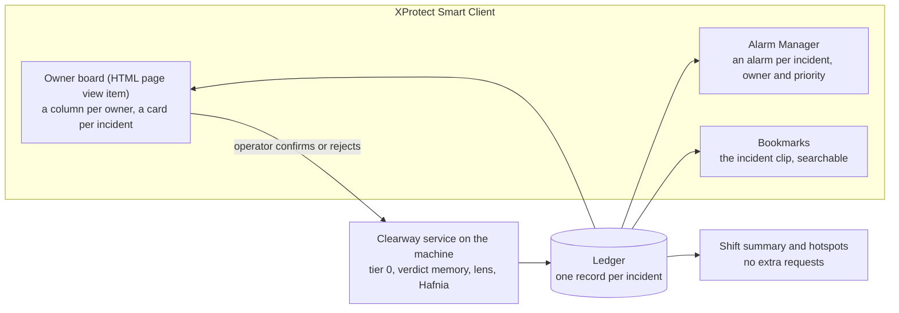

# Product plan: Clearway (working name), 2026-10-24

Status: **current.** This turns plan C (`docs/PLAN-C.md`, the pipeline and its measurements) into something an operator
uses. Plan C stays the technical reference; where the two disagree on scope or schedule, this document wins.
Submission about 2026-10-30. A "clearway" is a road where stopping is not allowed: the product keeps public ways clear.

## The operator's question

> **What is blocking a public way right now, whose job is it, and how long has it been there?**

Clearway answers it on one board, inside XProtect Smart Client. Each card is one incident: what it is, the short clip
that shows it, whose job it is, how long it has been open. Cards close themselves when the way is clear again. At the
end of a shift the board summarises what happened and where it keeps happening.

The pipeline we built (change detection, verdict memory, lens, Hafnia) is the reason to trust the board, not the
product itself. The pitch leads with the board and uses the measurements as evidence.

## Why this framing (evidence, 2026-10-24)

- **Every 2025 finalist built something a person uses** (a map, a triage view, a recap, a workflow builder); none
  improved the model (`docs/PLAN-near-miss.md`, "What earlier and current entries did"). The winner wanted something
  "relevant and useful in real life"; the judges (Milestone and NVIDIA) said he "really nailed it". The 2025 results
  name no criteria.
- **The organizers' own idea list** (`hackathon_qna.png`) names "Smart dashboards: turn video understanding into
  safety, traffic and incident dashboards for operators" and "Video summaries: shift summaries, explanations of unusual
  activity and structured data from hours of footage". The board and the shift summary are both on it.
- **Our gap:** plan C stops at "an alarm fires in XProtect". The ledger and the page that would show it to a person were
  still "to build" and scheduled last.
- **Our strength stays:** no 2025 entry measured or improved what the VLM sees. Here that work becomes product
  properties a judge can check: few false cards, the right clip on each card, no request wasted on repeats.

Source of the framing: an external review of the plan (2026-10-24), checked against the 2025 press material, the
organizers' list and Milestone's documentation.

## Who uses it

| Person | Where | What they need |
|---|---|---|
| Control-room operator (city or transit) | the board in Smart Client | what is open now, in which column, how long; confirm or reject a card |
| An owner team: rail control, traffic operations, sanitation, the e-scooter operator | their column; their XProtect alarm | only their incidents, with the clip that shows them |
| Planner (street or station) | the shift summary and hotspots | where incidents keep happening, how fast they are cleared |

## What a person sees

**A card** (one per incident):
- category and owner, as a coloured column (rail control, traffic operations, sanitation and street maintenance, the
  e-scooter operator, asset owner);
- the lens clip, playing in the card: the cropped, event-centred clip that Hafnia judged is also the best evidence for
  a person, so it does double duty;
- Hafnia's one-sentence summary, marked as AI-generated;
- time since the change began, and its state: open, cleared (closed by itself), confirmed or rejected by the operator;
- recurrences: "same spot, 3rd time today".

**The shift summary** (built from the ledger, no requests), in the shape of Hafnia's trained MonitoringSummary:
incidents by category and owner; median minutes from change to alarm and from alarm to clear; open longest; recurring
spots with a thumbnail.

**Hotspots:** per camera, where incidents keep coming back (from the ledger's boxes and the verdict memory's
embeddings), drawn over the camera image: "e-scooters left here 6 times this shift".

## Features and priorities

| # | Feature | Priority | Builds on | New work |
|---|---|---|---|---|
| F1 | Ledger (**built 2026-10-24**, `clearway/ledger.py`; offline replay `run/ledger-F1`: one card per incident, 9 requests for six incident cameras over 5 min instead of 190, no incident change lost with a stand-in for Hafnia) | P0 | `tier0/change.py` change ids and auto-close | One record per incident: camera, box, times (change, report, answer, alarm, clear), category, owner, Hafnia's answer, clip path, alarm id, bookmark, state, recurrence count, operator verdict. States: candidate → asked → open → cleared / confirmed / rejected. A change at the spot and with the look of an open or recently confirmed incident is a **recurrence**: no request, counter + 1. Without this, a looped incident costs a request every 15 s. |
| F2 | Live pipeline (**built 2026-10-25**, `clearway/service.py`, `scripts/run_clearway.py`; first live test `run/clearway-live-20261025T083623Z`: six incident cameras, 10 requests, one card per incident, 6 of 6 categories right, recurrences carded in 1.4–2.5 s, first cards 36–85 s after the change because the one lens camera plays the questions' clips in turn) | P0 | `incident/` (plan A), FrameBridge, `lens/`, `scripts/lens_pilot.py` prompt | FrameBridge → change detector → verdict memory → router (daily cap) → lens clip → Hafnia (JSON prompt with COLLISION) → ledger. |
| F3 | XProtect alarms and bookmarks (**built 2026-10-25**, `clearway/alarms.py`; dry runs `run/clearway-dry-20261025T090255Z`: one alarm per incident on its camera with the right priority, a snapshot and bookmarks on the camera and `lens_1`; closed once the incident has stayed cleared for 60 s, reopened when it recurs; 0 errors) | P0 | `hafnia/xprotect_rest.py` (trigger, update, close, bookmark) | One alarm per incident, priority and owner from the category, the clip span bookmarked; the alarm closed when the incident clears. |
| F4 | Owner board | P0 | `scripts/viz_pipeline.py` page code | A page served by the Clearway service on the machine (standard-library HTTP server, polling the ledger), cards with the clip (MP4 made from the lens spool), shown in Smart Client as an HTML page view item. |
| F5 | Person on the tracks | P0 | YOLO person boxes | A danger-zone polygon for the tracks camera (the only per-camera setting): feet inside for ≥ 1 s. Without it the rail-control column is empty. |
| F6 | COLLISION category | P0 | prompt | Gate G3 of plan C: **passed on the crop 2026-10-24** (`run/lens-test_11-20261024T110155Z`; the full frame still says STALLED_VEHICLE). Regression check passed (`run/pilot-20261024T111134Z`): the six synthetic incidents keep their categories, none becomes COLLISION; two summaries had wrong details, so the card shows category and clip first. |
| F7 | Operator confirm / reject | P1 | `tier0/memory.py` | Buttons on the card; the verdict is written into the verdict memory, so the next similar change at that spot follows the operator, and the XProtect alarm is closed with the reason. The system adapts to each site without retraining. |
| F8 | Shift summary | P1 | ledger | Counts, medians, longest open, recurring spots; a page and a JSON file; no requests. |
| F9 | Hotspots | P1 | ledger boxes, memory embeddings | Per-camera overlay of where incidents recur, with counts. |
| F10 | Map | P2 | camera positions | First a half-day check of XProtect's Smart Map: can cameras get positions from a script (MilestonePSTools) and do our alarms show on it? If yes, native. If not, a small map panel on the board with camera positions. |
| F11 | Person staying at a spot (gate) | P2 | YOLO person tracks | Footnote incident (tampering); only if time allows. |

**Cut** from plan C, to make room: injecting the CC0 street clips (and its Recording Server restart); M4 on real
footage shrinks to `test_11` alone (internal only, licence not cleared, so not shown in the demo). Super-resolution and
BEFORE/AFTER stills stay options. The stalled-vehicle track trigger is not needed: the change detector already catches
the breakdown.

## How it runs

- One Python service on the machine, `clearway`, in `.venv`: the pipeline, the ledger (JSONL plus a small state file)
  and the board's HTTP server on `127.0.0.1` (the Hafnia gateway is reachable only from the machine; Smart Client runs
  there too). Started detached like the lens publisher; one setup script for XProtect (alarm definitions, the HTML
  view, the lens camera).
- No secrets in code: the gateway password from `HAFNIA_GW_PASSWORD`; XProtect through the logged-in Windows user.
- Budget: the router reads `DailySummaryCount` and stops at a cap; recurrences and the verdict memory keep repeats free.

## How we show it is valid (operator terms first, accuracy beside them)

| Measure | Why an operator cares | From |
|---|---|---|
| False cards per camera per hour | workload | live shift run (M3) |
| Seconds from change to card and alarm; from clear to closed | response time | ledger timestamps |
| Requests per camera per day, and cameras one 500-a-day allowance covers | cost | ledger, gateway count |
| Category right, claims checked against the frames | can the card be trusted | Hafnia answers, audited as in `run/probe-20261022T054342Z/audit.md` |
| Operator corrections that changed later decisions | does it adapt | F7 log |

Honesty rules for the demo and the report: the organizers' clips loop every 8–17 s, so an incident "clears" when its
clip restarts and comes back as a recurrence a few seconds later; we say so. Hotspot counts on loops are replays of one
incident, so the hotspot feature is shown on them but no planning claim is made from them. Every measured number points
to a run folder.

## Demo story (video, about 3 minutes)

A day in the life, on the shared cameras so any judge can rerun it:
1. The board is quiet. A man drops an e-scooter across the pavement; within seconds a card appears in the e-scooter
   operator's column with the clip and "the rider dismounts and leaves the scooter lying on the pavement".
2. A person climbs down onto the tracks: a red card in rail control, an urgent alarm in Alarm Manager.
3. A pickup breaks down with smoke: traffic operations.
4. The bin is tipped over: sanitation. The operator rejects a false card (a shadow); the next similar shadow is skipped.
5. The scooter's spot is clear again: the card closes itself, no request spent.
6. End of shift: the summary. Seven incidents, owners, minutes to clear, the spot where e-scooters keep being left.
7. Close with the evidence: why the clips are cropped and centred (the gate told backwards over a full loop), the
   verdict memory's saving, requests used.

## Pitch outline (5 slides)

1. The question: what is blocking a public way right now, and whose job is it? (the board)
2. The demo: cards per owner, clips, auto-close, the summary.
3. Why it can be trusted: tier 0 sees every frame for free; Hafnia is asked only about real changes, shown the moment
   and the spot (the walkthrough figures, `docs/walkthrough/`).
4. Numbers in operator terms: false cards per hour, seconds to alarm, cameras per allowance; accuracy beside them.
5. What it adapts to: operator corrections into the memory; hotspots for planners; what we did not claim.

## Schedule (replaces plan C's from Oct 24)

The allowance resets at 00:00 UTC; stay under the cap each day.

| Day | Date | Work | Requests |
|---|---|---|---|
| 3 | Oct 24 | This plan. G3 (COLLISION, 3). Ledger with recurrences (F1), replayed offline on recorded detector output. Pipeline service skeleton (F2). | 10 |
| 4 | Oct 25 | Live pipeline on the six incident cameras (F2); XProtect alarms, bookmarks, auto-close (F3); danger zone for the tracks (F5). | 60 |
| 5 | Oct 26 | Owner board with clips (F4), in a browser and in a Smart Client HTML view; confirm / reject (F7). Machine restart (organizers; participant). | 40 |
| 6 | Oct 27 | Shift summary (F8) and hotspots (F9); Smart Map check (F10, half a day). A live shift on all eleven cameras for 2–4 hours (M3). | 150 |
| 7 | Oct 28 | Report in operator terms with accuracy and audits; `test_11` (M4); fixes. | 60 |
| 8 | Oct 29 | Demo video; `setup.ps1`, README (opens with the board). | 30 |
| 9 | Oct 30 | Spare; submission. | |

## Risks

| Risk | Fallback |
|---|---|
| Smart Client's HTML view cannot play the clip or poll the service | Show the clip as an animated image; open the board in a browser beside Smart Client |
| Loops make "time open" trivial (seconds) | Say it; show auto-close as the mechanism; real minutes only on `test_11` (internal) |
| Recurrence matching merges two different incidents at one spot | The memory checks the look as well as the spot; the operator can split by rejecting |
| The board becomes a second alarm list | Alarms stay in Alarm Manager (operators' habit); the board is for owners and the overview, and links each card to its alarm |
| Not enough time for P1 | P0 alone is a complete product (cards, clips, alarms, auto-close); P1 adds adaptation and analysis |

## Sources

- 2025 finalists and the winner's quote: `docs/PLAN-near-miss.md` and its sources
- The organizers' idea list: `hackathon_qna.png`
- Smart Client web page view item: https://doc.milestonesys.com/2025R1/en-US/standard_features/sf_sc/sf_createviews/sc_addotherwebp.htm
- Smart Map overview (alarms on maps not confirmed for our case): https://www.milestonesys.com/articles/xprotect-smart-map/
- Hafnia's trained output formats (MonitoringSummary): `docs/PLAN-near-miss.md`, "Why consider a change"
- The pipeline and its measurements: `docs/PLAN-C.md`, `docs/walkthrough/`
